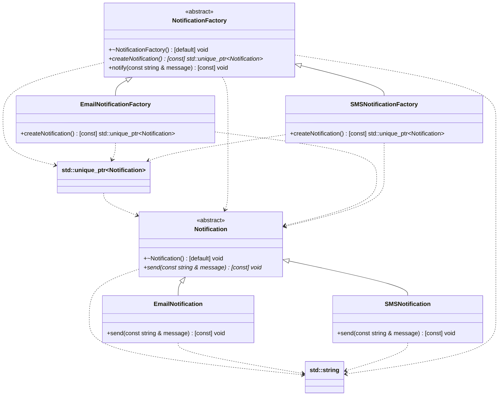
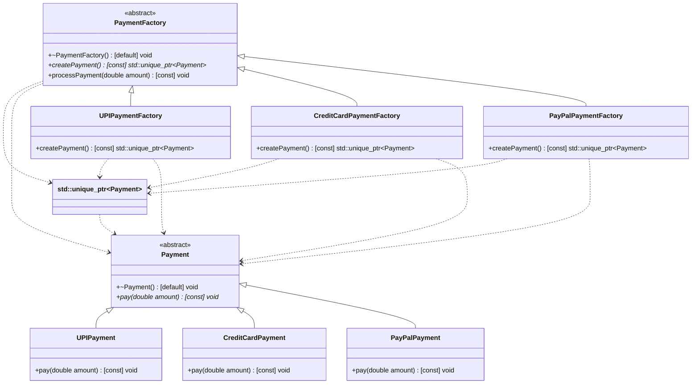

# Design Patterns

This repository contains C++ factory-pattern examples. These class diagrams are
generated from the source with [clang-uml](https://github.com/bkryza/clang-uml).

## Notification factory

<!-- UML:notification_factory:start -->


<!-- UML:notification_factory:end -->

## Payment factory

<!-- UML:payment_factory:start -->


<!-- UML:payment_factory:end -->

## Generate diagrams locally

Install `clang-uml`, CMake, and a C++ compiler, then run:

```sh
cmake -S . -B build -DCMAKE_EXPORT_COMPILE_COMMANDS=ON
cmake --build build
clang-uml --progress --query-driver /usr/bin/c++
clang-uml -g mermaid --query-driver /usr/bin/c++
python3 scripts/embed_diagrams.py
```

GitHub Actions regenerates the source diagrams and updates this README when C++
source or diagram configuration changes are pushed to `main`. PlantUML source
files are also saved in [`docs/diagrams`](docs/diagrams). You can run the
workflow manually from the repository's **Actions** tab.
